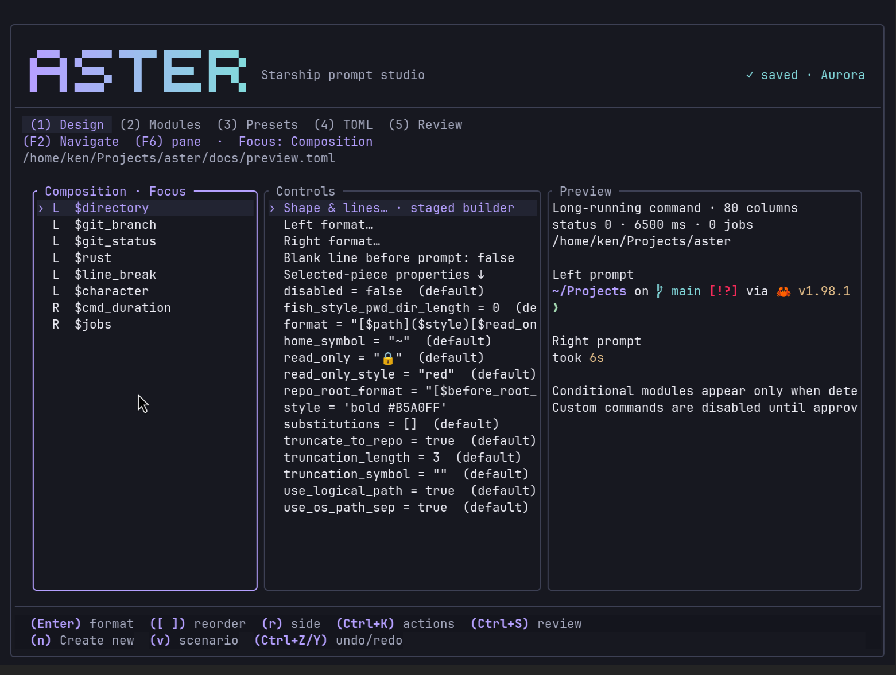
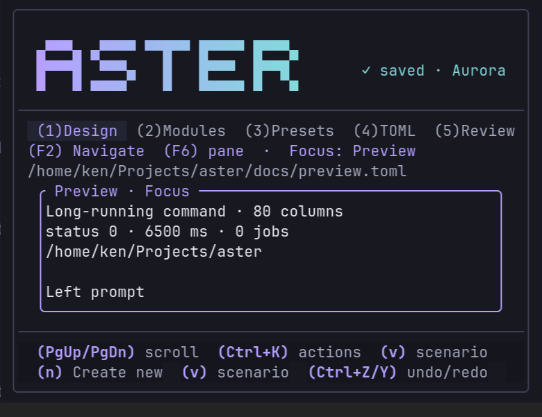

# Aster

An Aurora terminal studio for [Starship](https://starship.rs) prompts. Aster opens your current prompt ready to edit, with simple controls, a live preview, presets, and an Advanced area for technical settings.



## Install

Rust **1.88 or newer** and Starship are required for building and real previews.

```bash
git clone https://github.com/design-nexus/aster.git
cd aster
./install.sh
```

Or:

```bash
curl -fsSL https://raw.githubusercontent.com/design-nexus/aster/main/install.sh | bash
```

Installation uses a locked release build and writes `~/.local/bin/aster`. `./install.sh --prefix DIR` selects another prefix. No compatibility command alias is added.

```bash
aster              # edit your current prompt
aster --edit       # advanced module settings
aster --wizard     # staged guided creation
aster --no-mouse    # leave terminal text selection available
```

Aster respects `$STARSHIP_CONFIG`; otherwise it uses `~/.config/starship.toml`. Missing files start empty. Unreadable files block saving; malformed TOML opens with its original text and diagnostics.

## Workspace

- **Edit prompt:** the preview stays at the top. Pick a named part on the left and click a value on the right. The Editing indicator names the selected part and value. All common settings are in one list. Every common setting explains its effect. Click a setting or press Enter; text fields accept plain text without TOML quotes. Tab switches between parts and settings; Enter edits the selected value.
- **Add part** adds content; **New prompt** opens a staged guided replacement. Automatic Starship content can be expanded into individual parts without changing its order. Styled expressions expose their modules while retaining their original text. Structural edits that cannot safely separate a shared group explain why and point to Advanced.
- **Save** and Ctrl+S validate, back up, and save directly. Undo/Redo remain available before saving. Saving does not require a separate review screen.
- **Presets:** includes Aster originals and installed Starship presets. Select one to preview; Enter opens replacement review. Adopt replaces the draft; Cancel keeps your current work.
- **Advanced:** full module settings, TOML Source, optional Review changes, raw format editing, and Aster appearance. Unknown properties are labeled undocumented. Source retains invalid text and diagnostics; Ctrl+Enter applies it, and Ctrl+S validates and saves it.

Prompt themes include terminal colors and named palettes. Text/background colors and icons can also be changed per part. Prompt colors and Aster’s own appearance are separate. Some surrounding decorations share a styled group’s color. Conditional parts only appear when Starship detects the appropriate directory or runtime conditions.

Technical property editing under Advanced accepts TOML values, including arrays and quoted strings. An empty string is `""`; Delete removes the selected property key. Actions can add `path = value`.
Create new stages shape, lines, content, colors, and icons. Enter advances and finishes; Esc goes back, and `x` cancels the entire builder. F6 shows its live preview in compact terminals. Finishing adopts the staged result without saving. Existing comments, symbols, unknown keys, OS symbol mappings, and unrelated settings are retained by ordinary edits. Preset adoption explicitly replaces the draft.

## Navigation and previews

- 1 opens Edit prompt, 2 opens Presets, and 3 opens Advanced. Tab moves between the main areas.
- F6 / Shift+F6 changes panes. Each screen remembers its focus and selection.
- F2 opens searchable Navigation; Ctrl+K opens actions.
- Arrows / j / k moves lists; Page Up / Down scrolls. Left/right scrolls long Preview or TOML lines.
- Ctrl+S saves directly. Ctrl+Z / Ctrl+Y undoes/redoes valid document edits outside text input.
- F1 / `?` shows help. `q` and Ctrl+C share the unsaved-change guard. Input and dialogs own shortcuts while open.

At 100 columns and wider, controls and previews appear together. Narrower views stack panes; at 80×24 and smaller the focused pane expands. The everyday editor always shows parts and settings beneath the pinned preview, including on smaller terminals. Mouse clicks focus panes and select rows; wheel movement affects the pane beneath the pointer. Dialog buttons use the same guarded actions as the keyboard.

`v` cycles Current directory, Successful command, Failed command, Long-running command, and Background jobs. Actions and Navigation expose scenarios; Actions also edits directory, width, exit status, duration in milliseconds, and job count. Starship renders both left and right prompts against private temporary configuration copies. Preview viewports scroll without rewrapping the prompt.

Custom command modules, including `when` scripts, are disabled in preview copies until you approve the displayed definitions for the session through Actions. Changing their definitions revokes approval. Your actual draft is retained. Preview jobs are debounced, obsolete jobs are discarded, subprocess groups time out, Ctrl+X cancels rendering, and temporary files are cleaned up. Detection uses the chosen directory; conditional modules can legitimately produce no output.

Aurora is the default appearance. Actions cycles Aurora, Follow Omarchy, and Terminal; the choice is stored under the XDG data directory in `aster/appearance`, separately from prompt colors. Follow Omarchy refreshes its palette while Aster runs. There is no crimson appearance.

## Saving and verification

Save validates TOML and known property types, checks for external file changes, creates a unique backup beside the resolved target, preserves file permissions, and atomically replaces the file. Configuration symlinks remain symlinks. Read-only targets and existing Save as destinations are rejected. Errors leave the draft available.

```bash
cargo fmt --check
cargo test --locked
cargo build --release --locked
python3 tests/terminal.py target/release/aster
```

See [verification notes](docs/VERIFICATION.md) for the render matrix, Foot captures, terminal restoration checks, and their limits. Capture tooling and a temporary prompt fixture are in `docs/`; they never install that fixture as your prompt.


